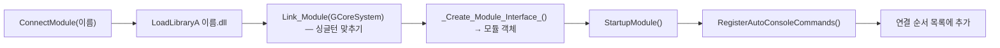

# Core

**한 줄 요약**: 엔진의 바닥. 프로세스 시작 · 프레임 루프 · 종료(`GCoreSystem`), 모듈(DLL) 연결, 메모리 풀과 스마트 포인터, 리플렉션, 대리자, 콘솔 명령, 창 · 입력 · 파일 · 로그 · 수학이 모두 여기 있다.

**그림으로 보기**: [[Core 그림 설명]] — 위 덩어리마다 장면 · 구조도 · 흐름도(그림 23장).

| 항목 | 내용 |
|---|---|
| 형식 | **StaticLib**(정적 라이브러리), 의존 없음, 정의 `_CORE`. 다른 모든 모듈 · 프로그램에 링크된다 |
| 담당 세션 | `Core`(2026-10-07 Data · Memory 세션 통합). 다른 세션이 Core 를 고치면 Core 세션에 알린다 |
| 크기 | 96파일 · 약 1.8만 줄(2026-10-17) |
| 주의 | 정적 라이브러리라 **EXE 와 각 DLL 에 Core 사본이 따로** 들어간다 → 싱글턴은 DLL 마다 `Link_Module(GCoreSystem*)` 로 EXE 의 것에 맞추고, 경로 같은 전역 값은 매번 `GCoreSystem` 전역 값에서 읽는다 |

## 폴더 · 주요 파일

`C:/Develop/JGEngine/Source/Runtime/Core/`

| 폴더 | 주요 파일 | 하는 일 |
|---|---|---|
| (루트) | `Core.h` · `CoreDefines.h` · `CoreSystem.h/.cpp` | 묶음 헤더, 기본 타입 · `JG_WITH_EDITOR`(에디터 빌드 1 / 패키지 0), `GCoreSystem` |
| `ConsoleCommand/` | `ConsoleCommandGlobalSystem.h/.cpp` · `ConsoleCommandArgs.h/.cpp` | 콘솔 명령 레지스트리 · `HAutoConsoleCommand` · 인자 파서. **헤더 머리 주석이 사용법 원본** |
| `FileIO/` | `FileHelper` · `Json` · `Jsonable.h` · `ProjectDescriptor` · `PackageDescriptor` | 파일 읽기 · 쓰기 · 원자적 쓰기, 엔진/프로젝트/Content/Saved 경로, rapidjson 래퍼, `.jgproject` · `JGPackage.json` 읽기 |
| `Input/` | `InputEvent.h` · `Key.h` | 엔진 입력 이벤트 `HInputEvent`(GP-C1, 10-02) · `EKeyCode` |
| `Math/` | `Vector` · `Matrix` · `Quaternion` · `Rect` · `Ray` · `Plane` · `Frustum` · `BBox` · `Color` | `HVector2/3/4` · `HMatrix` · `HRay` 등 |
| `Memory/` | `Memory.h/.cpp` · `MemoryPool.h/.cpp` · `Allocator.h` | GC 객체 · `PSharedPtr`/`PWeakPtr` · 스레드별 크기 클래스 풀 · 컨테이너 할당자 |
| `Misc/` | `Module` · `Delegate.h` · `Log` · `Timer` · `Guid` · `Hash` · `DateTime` · `DevelopUnit` | 모듈 시스템 · 대리자 · 로그 · 타이머 · 보조 타입 |
| `Object/` | `ObjectDefines.h` · `JGType.h` · `JGObject` · `ObjectGlobals` · `ObjectGlobalSystem` | 리플렉션 표시 매크로 · 타입 ID · 메타 클래스 · 레지스트리 · `SaveObject/LoadObject` |
| `Platform/` | `Platform.h/.cpp` · `JWindow.h/.cpp` · `Windows/WindowsJWindow` · `Windows/WindowsInput` | `HPlatform`(DLL · 창 · DPI · 클립보드 · IME), Win32 창 · 메시지 펌프 · 입력 변환 |
| `String/` | `String` · `Name` · `StringTable` | `PString` · 인턴 문자열 `PName` · `GStringTable` |
| `Thread/` | `Scheduler` · `Thread` · `Task` · `MainThreadExecutionOrder.h` | 메인 스레드 프레임 작업 · 비동기 스레드 · 프레임 단계 |

## 핵심 클래스 · 개념

### 이름 접두어 (코드에서 확인한 관례)

| 접두어 | 뜻 | 예 |
|---|---|---|
| `G` | 전역 시스템(싱글턴) | `GCoreSystem` · `GModuleGlobalSystem` · `GAssetDatabase` |
| `P` | 메모리 시스템이 관리하는 객체(대부분 `IMemoryObject` 파생) | `PSharedPtr` · `PString` · `PWorld` |
| `H` | 값 타입 · 정적 도우미 · 별칭 · 모듈 클래스 | `HVector3` · `HFileHelper` · `HList` · `HGameHostModule` |
| `JG` | 리플렉션 객체(JGCLASS) | `JGObject` · `JGActor` · `JGWidget` |
| `I` · `E` | 인터페이스 · enum class | `IModuleInterface` · `ELogLevel` |

명문화된 규칙 문서는 없다(지침서는 "시스템 이름은 접두어로 자연스럽게 읽혀야 한다"는 일반 원칙만). 위 표는 정의에서 추정한 것이다.

### `GCoreSystem` — 시작 · 프레임 · 종료

전역 시스템(`GGlobalSystemInstance<T>`, 가상 `Start` · `Update` · `Destroy`)을 등록 순서 목록으로 갖는다.

| 단계 | 하는 일(`CoreSystem.cpp`) |
|---|---|
| `Create(args)` | ① 시스템 등록: Log → Memory → Timer → Schedule → StringTable → ConsoleCommand → Module → Object ② 루트 경로 결정(아래) ③ 코드젠 등록 `GObjectGlobalSystem::codeGen()`(DLL 마다 리플렉션 등록) ④ **실행 모듈(LaunchModule) 연결** — `JGEditor` 또는 `GameHost` ⑤ 모든 시스템 `Start()` ⑥ 실행 불가면 종료 코드 2 |
| `Update()` | 등록 순서대로 모든 시스템 `Update()` = **프레임 1회**. 메모리 GC → 타이머 → 스케줄러(프레임 단계 작업) → 문자열 정리 → 콘솔 명령(`Submit` 된 줄 실행) → 모듈이 등록한 시스템 |
| `Destroy()` | 창 · 창 콜백 비움 → 시스템 `Destroy()` **역순**(이때 모듈이 연결 역순으로 `ShutdownModule`) → GC Flush → Core 시스템 해제(StringTable → ConsoleCommand → Object → Module → Schedule → Timer → Memory → Log) → DLL `FreeLibrary` |

**루트 경로 결정**(에디터 빌드): 툴 인자 `-project=` → 실행 파일 기준 `../../` 에 `*.jgproject` 가 있으면 프로젝트 모드(엔진 위치는 `.jgproject` 의 `EngineRoot` → 환경변수 `JGENGINE_ROOT`) → 둘 다 아니면 엔진 단독(`../../` = 엔진). 패키지 빌드는 패키지 폴더가 엔진 = 프로젝트 루트이고 `Bin/JGPackage.json` 을 읽는다.

### 프레임 단계 (`Thread/MainThreadExecutionOrder.h`)

스케줄러 `GScheduleGlobalSystem` 은 메인 스레드 작업을 이 순서로 돈다: **GraphicsBegin → Begin → Update → End → GraphicsEnd → UpdateWindow**.

| 단계 | 누가 걸어 두나 |
|---|---|
| GraphicsBegin | Graphics `BeginFrame`(펜스 대기 · 미룬 해제) · GUI `NewFrame`(ImGui) |
| Update | GameFrameWorks `tick`(게임 인스턴스 · 월드 · 게임 UI) · GUI 위젯 `OnUpdate` |
| End | GameHost `renderFrame`(게임만 실행 때 그리기 · 제출) |
| GraphicsEnd | Graphics `EndFrame`(업로드 기록 → 백 버퍼 → 리드백 → 제출 → Present) |
| UpdateWindow | Win32 메시지 펌프(`WM_QUIT` 이면 루프 끝) |

- `ScheduleByFrame` · `Schedule`(초 단위) · `ScheduleAsync(ENamedThread, …)`(작업 스레드 `hardware_concurrency` 개). **작업 취소 API 는 없다**(GUI 2-1 보류).
- 콘솔 명령 `Submit` 은 다음 프레임의 ConsoleCommand 시스템 `Update` 에서 — 즉 **프레임 밖**에서 돈다.

### 모듈 시스템 (`Misc/Module.h/.cpp`)

풀이: DLL 은 `JG_MODULE_IMPL(모듈클래스, <모듈>_C_API)` 로 진입 함수 두 개를 내보낸다. 이미 연결된 모듈이면 true 만 돌려준다(**참조 수 없음** — `ShutdownModule` 에서 의존 모듈을 끊지 않는다). `DisconnectModule` 은 명령 해제 → `ShutdownModule` → GC Flush 순(DLL 은 내리지 않음). 엔진 종료 때는 연결의 **역순**으로 내린다(2026-09-17 종료 크래시 수정 `cd1a1d6`).

### 메모리 — 풀 · GC · 스마트 포인터

| 개념 | 내용 |
|---|---|
| 풀 `HMemoryPool` | 스레드마다 청크 하나, 크기 클래스 18개(8B~1MB), 비면 64KB 페이지를 더한다(고갈 없음). 1MB 초과는 대형 블록. 모든 블록 앞 16B 헤더. 다른 스레드 반납은 lock-free 스택. 10초 안 쓴 빈 페이지는 회수 |
| GC 객체 | `Allocate<T>(…)`(T 는 `IMemoryObject` 파생이어야 함). **참조 수가 0 이 되어도 바로 지우지 않고** 다음 프레임 GC 가 파괴한다(프레임 N 에 놓은 것은 N+1 시작에) |
| 스마트 포인터 | `PSharedPtr<T>` · `PWeakPtr<T>`(`Pin()` 으로 강참조). 제어 블록은 CRT 힙 |
| 컨테이너 | `HList` · `HHashMap` · `HMap` · `HSet` … = 풀 할당자를 쓰는 STL 별칭 |
| 상태(2026-10-17) | 메모리 시스템 **완료 · 휴면**(2026-09-30 사용자 완료 처리). 상주 메모리 428 → 230MB, 약참조 UAF 제거(4-1). 나머지는 보류 확정 |

### 리플렉션 · 코드 생성

- 표시 매크로 `JGCLASS` · `JGPROPERTY` · `JGFUNCTION` · `JGENUM` · `JGENUMMETA` 는 빈 매크로다. **JGHeaderTool** 이 헤더를 읽어 `Temp/CodeGen/<Module>/<File>.generation.h/.cpp` 와 `<Module>.codegen.generate.cpp` 를 만든다(→ [[엔진 프로그램]]). `JGSTRUCT` 는 빈 매크로로만 있고 처리하지 않는다.
- 각 DLL 은 `Engine_CodeGenerate` 를 내보내고, `GObjectGlobalSystem::codeGen()` 이 시작할 때 모듈 목록의 DLL 마다 불러 클래스를 등록한다. 목록 = 에디터 `Temp/CodeGen/module_system_info.json`, `-game` 실행 `runtime_module_info.json`, 패키지 `JGPackage.json` 의 RuntimeModules.
- API: `StaticClass<T>()` · `Cast<T>` · `AllocateByClass` · `SaveObject/LoadObject`(JSON `{JGObjectType, JGObject}` — `.jgasset` 형식의 바탕).

### 대리자(Delegate) · 콘솔 명령 · 로그

| 시스템 | 핵심 |
|---|---|
| 대리자 `Misc/Delegate.h` | `HDelegate` · `HMulticastDelegate`(`AddRaw/AddStatic/AddLambda/AddSP` → 핸들, `Remove` · `RemoveObject` · `RemoveAll` · `BroadCast`). 람다는 **값으로** 저장(ER-023, 10-11). 방송 중 해제는 핸들만 무효로 하고 바깥 방송이 끝날 때 지운다(10-11 버그 수정) |
| 콘솔 명령 | `.cpp` 파일 범위에 `static HAutoConsoleCommand X("area.action", "사용법", "설명", 람다);`. DLL 의 명령은 `StartupModule` 직후 등록 · `ShutdownModule` 직전 해제. 이름은 소문자 `영역.동작`, 인자 `-key=value`. `Execute`(바로) / `Submit`(다음 프레임, 프레임 밖 — DevConsole 창). Core 자체는 `help` 하나만 등록 — **Core 에 명령을 선언하지 않는다**(규칙) |
| 로그 | spdlog 래퍼 `GLogGlobalSystem`, `JG_LOG(카테고리, ELogLevel::X, "printf 형식", …)`. 파일 = 작업 폴더 `jg_log.txt`(시작 때 비움, 패키지는 `Saved/Logs/<이름>.log`). warn 이상만 즉시 flush. 최근 1024줄을 DevConsole 이 읽는다 |

### 창 · 입력 · 플랫폼

- `HWindowCallBacks`(전역 하나): `WndProc`(에디터 ImGui 가 씀) · `OnResize` · `OnInput`. 창 모드 `EWindowMode` = Windowed · BorderlessFullscreen.
- **입력 계층(GP-C1)**: Win32 메시지 → `HWindowsInputTranslator` → `HInputEvent`(포인터 이동 · 누름 · 뗌 · 휠 · 나감, 키, 확정 글자 UTF-32, 포커스). `OnInput` 구독자가 있을 때만 변환한다(GameHost 가 구독, 에디터는 안 함).
- `HPlatform`: DPI 인식(Per-Monitor V2, D-22 ②) · `GetDpiScale` · 클립보드 · IME 위치(`SetImeCompositionRect`).

### 파일 · 경로 (`FileIO/FileHelper`)

| 함수 | 에디터 빌드 | 패키지 |
|---|---|---|
| `EngineContentDirectory()` | `<Engine>/Content` | `<Pkg>/Content/JGEngine` |
| `GameContentDirectory()` | `<Project>/Content` | `<Pkg>/Content/JGGame` |
| `EngineShaderDirectory()` | `<Engine>/Content/Shaders` | `<Pkg>/Content/JGEngine/Shaders` |
| `SavedDirectory()` | `<Project>/Saved` | `<Pkg>/Saved` |

- 패키지에서 Content · Saved · Bin 밖을 읽으면 폴더마다 한 번 경고(`Package reads outside Content/Saved/Bin`) — 쿠킹 스모크가 이것을 센다.
- `WriteAllTextAtomic` = `<path>.tmp` 에 쓰고 rename(데이터 테이블 저장).
- **경로는 ASCII 만**(한글 파일 경로 요청 ER-004 반려, D-26).
- 에셋 토큰 `/JGEngine/` · `/JGGame/` 은 Core 가 아니라 [[Asset]] 이 정의한다(Core 는 폴더만 준다).

## 다른 모듈과의 관계

| 방향 | 대상 |
|---|---|
| 쓰는 것 | ThirdParty — spdlog 1.10.0 · rapidjson 1.1.0(PCH 에 넣어 빌드 속도 개선, BS-2) |
| 쓰이는 것 | 모든 모듈 · 프로그램([[Graphics]] · [[Asset]] · [[GameFrameWorks]] · [[GUI]] · [[Audio]] · [[Devkit]] · [[GameHost]] · [[AI]] · [[JGEditor와 도구 창]] · [[엔진 프로그램]]) |
| 모듈이 등록하는 전역 시스템 | `GAssetDatabase`(Asset) · `GShaderLibrary`(Graphics) · `GAudioGlobalSystem`(Audio) |

## 확인 방법

`Bin/DevelopEngine/JGConsole.exe <명령>` — Core 의 자체 검사 명령은 규칙대로 Core 밖(JGConsole)에 있다.

| 명령 | 대상 | 기대(최근) |
|---|---|---|
| `console.selftest` | 콘솔 명령 레지스트리 · 파서 · 최근 로그 | `OK (64/64)` |
| `delegate.selftest` | 대리자(주인 찾기 · 방송 중 해제 · 람다 저장) | `OK (34/34)` |
| `input.selftest` | 입력 변환(가짜 메시지) | `OK (34/34)` |
| 런처 60초 | `Document/Memory/tools/crashwalk/crashwalk.exe "<Bin>\JGLauncher.exe" <Bin> 60` | 종료 0 · `[error]` 0 · `Memory Chunk Shutdown … live blocks 0` |

Core 헤더를 바꾸면 거의 모든 모듈이 다시 컴파일된다(PCH 경유). 바꾼 뒤 위 명령 + `gmtest` · `gameui.selftest` · `datatable.selftest` · `net.test all` 회귀를 돈다.

## 지금 상태 · 남은 일 (2026-10-17 기준)

| 항목 | 상태 |
|---|---|
| 메모리 시스템 Phase 0~2 · 4-1 · 통계 창 UI-1 | 완료 · 커밋(`fcace8f` · `d457b92` · `4c8ac73` · `736ddbe`). 휴면 |
| 콘솔 명령 시스템 Phase 0~4 | 커밋 `4c8ac73` |
| 이벤트 구독 해제 버그 · 람다 저장(ER-023) | 완료 10-11, **미커밋** |
| 입력 계층(GP-C1) · DPI(D-22 ②) · 패키지 경로(GP-D1) | 완료 · 메인 반영, **미커밋** |
| 보류 | 대리자 3건(방송 중 추가 시 콜백 이동 · 죽은 SP 구독 잔류 · `Compress()` 논리 오류), 잘못된 GUID 예외(DT-H16), 런처 인자로 명령 실행(B-1) |
| 선행 조건 요청 | GFW 프리팹(2-6)이 `PJsonData::getJGObject` 미등록 타입 처리를 기다린다 |

## 알아둘 함정

- **엔진 컨테이너를 static 저장소에 두지 않는다** — DLL 언로드의 atexit 소멸자가 죽은 풀을 읽어 0xC0000005.
- 풀 `Allocate/Deallocate` 정상 경로에서 `JG_LOG` 금지(문자열 · 로그가 풀을 써 무한 재귀).
- `IMemoryObject` 뿌리는 정확히 하나(다중 상속 금지 — `Allocate<T>` 변환이 모호해진다).
- `PSharedPtr` 를 든 전역 객체는 모듈 `ShutdownModule` 에서 놓는다.
- **JGConsole 은 `GCoreSystem::Update()` 를 부르지 않는다** → GC · 스케줄러 · 풀 Tick 이 돌지 않는다. 헤드리스 시나리오를 쌓으면 `GMemoryGlobalSystem::Flush()`.
- 종료 코드 읽기: `0xC0000005` = 종료 순서 버그, `3` = 예외 · assert · abort, `4` = crashwalk 가 멈춘 프로세스를 끊음.
- `PJsonData::FindMember` 는 값을 **옮겨 온다** — 같은 키를 두 번 찾으면 두 번째는 null.
- `JG_LOG` 는 printf 방식(`{0}` 은 글자 그대로). `PSharedPtr` 에는 `operator bool` 이 없다 → `.IsValid()`.
- 대리자: 복사할 수 없는 람다(`unique_ptr` 캡처)는 걸 수 없다. 방송 중 콜백 안에서 `GetSize()` 는 뺀 구독을 아직 센다.
- Windows 매크로(`min/max` · `PlaySound` · `small/near/far`) 와 이름이 부딪힌다.

## 참고 문서

| 문서 | 경로 |
|---|---|
| Core 현황(§1 메모리 · §3-4 대리자 · §5 함정 · §6 검증) | `C:/Develop/JGEngine/Document/Memory/Core/현황.md` |
| Core TODO(첫 표 = Core 공용 · 콘솔 명령) | `C:/Develop/JGEngine/Document/Memory/Core/TODO.md` |
| 콘솔 명령 시스템 구현 상세 · 검증(Etc §1) | `C:/Develop/JGEngine/Document/Memory/Etc/현황.md` |
| 대리자 수정 검증 | `C:/Develop/JGEngine/Document/Memory/Core/Files/2026-10-11_delegate_unsubscribe_fix_verify.txt` |
| 람다 저장(ER-023) 검증 | `C:/Develop/JGEngine/Document/Memory/Core/Files/2026-10-11_ER-023_lambda_storage_verify.txt` |
| 입력 계층 검증 | `C:/Develop/JGEngine/Document/Memory/Etc/Files/2026-10-02_GP-C1_input_layer_verify.txt` |
