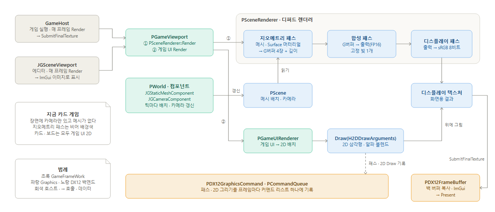
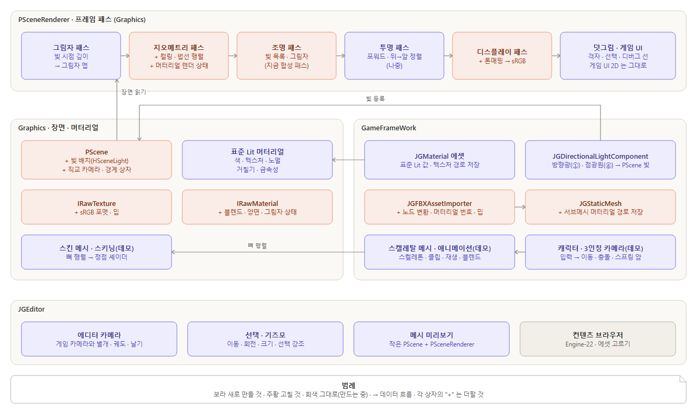

# 렌더링 파이프라인 구조 · 3D 렌더링 기능 검토 — Engine-27 (Graphics 초안, 2026-10-24 18:35 · 데모 내용 더함 18:42)

사용자 요청(대시보드 18:17): 지금 렌더링 파이프라인의 짜임을 검토한다. 그리고 카드 게임용 2D 렌더링에서 3D 렌더링으로 가는 데 필요한 기능을 전반적으로 검토한다.
사용자 덧붙임(보고함 Q-003 답, 18:29): "나중에 애니메이션이나, 3D 3인칭 테크 데모도 만들 예정" — 그래서 그 데모까지 필요한 것도 함께 검토했다.
범위: 코드를 읽고 검토만 했다. 코드 고치기는 사용자가 정한 뒤 설계도부터 한다. 기준 코드는 main `332104d` 이다.

## 결론

- **3D 의 뼈대는 이미 있다.** 장면(`PScene` — 메시 배치 · 원근 카메라)을 디퍼드 렌더러(`PSceneRenderer`)가 그린다. 순서는 지오메트리 패스(G버퍼 4장 + 깊이) → 합성 패스 → 디스플레이 패스(sRGB)다. 게임 UI 2D 는 그 결과 위에 얹는다. 메시(FBX → `JGStaticMesh`), 머터리얼(HLSL 조각 → 셰이더 템플릿), 깊이 테스트, 궤도 카메라, 광선 피킹도 이미 동작한다.
- **지금 카드 게임은 3D 장면을 비워 둔 채 2D 로만 그린다.** 장면에는 카메라 하나만 있고 메시가 없다. 카드 · 보드는 모두 게임 UI 2D 경로(`H2DDrawArguments`)로 그린다. 3D 패스는 매 프레임 돌지만 배경색만 남긴다.
- **3D 로 가려면 크게 새로 만들 것:**
  - 빛(지금은 합성 셰이더에 고정 방향 하나가 박혀 있다)
  - 그림자
  - 머터리얼 에셋(저장 · 불러오기 · 메시 슬롯 연결)과 표준 Lit 머터리얼
  - 에디터 3D 조작(에디터 카메라 · 선택 · 기즈모)
- **먼저 고칠 것.** 3D 에서 바로 눈에 띄는 문제다.
  - 색 텍스처를 sRGB 로 읽지 않는다 → 옅게 보인다.
  - 법선을 월드 행렬로 그대로 변환한다 → 크기를 축마다 다르게 주면 조명이 틀린다.
  - 밉맵이 없다 → 멀리 있는 면이 반짝인다.
  - FBX 노드 변환 · 머터리얼 번호를 버린다 → 가져온 언리얼 메시가 Z 위 · cm 그대로 들어오고(Engine-26 에서 확인), 흰 기본 머터리얼로 보인다.
  - 머터리얼이 블렌드 · 양면 상태를 정하지 못한다 → 모두 기본값(뒷면 컬링 · 불투명)으로 그린다.
- **권하는 순서(렌더링):** ① 빛 → ② 보이는 값 바로잡기 → ③ 머터리얼 → ④ 에디터 3D 뷰포트 → ⑤ 그림자 → ⑥ 빛 여러 개 · 컬링. 합계는 대략 18~22 작업일이다(분야 세션이 나눠 하면 달력으로 2주 안팎).
- **3인칭 3D 테크 데모(애니메이션)까지 가려면** 렌더링 밖에 두 트랙이 더 필요하다.
  - ⑦ 스켈레탈 메시 · 애니메이션: 가져오기 · 스키닝 · 재생
  - ⑧ 캐릭터: 게임 입력 → 조작 · 3인칭 카메라 · 이동과 충돌
  - 데모까지 합계는 대략 35~46 작업일이다(달력으로 4~5주 안팎, GameFrameWork 몫이 가장 크다).
- **작게 시작할 첫 단계:** "방향광 하나를 장면 데이터로". 셰이더 코드에 박힌 빛을, 장면에 놓고 돌릴 수 있는 빛으로 바꾸는 일이다.
  - 1.5일이 걸리고 다른 일감과 겹치지 않는다. 렌더 자체 시험(`graphics.selftest`)으로 전후를 바로 잴 수 있다.
  - 데모 화면의 빛 · 그림자가 이 위에 서므로, 데모로 그대로 이어진다.
  - 데모의 가장 큰 위험은 뼈 · 애니메이션이 든 시험 에셋이 아직 없다는 것이다. 그래서 시험 에셋 확보(0.5~1일)를 첫 단계와 나란히 하기를 권한다.

---

## 1. 지금 파이프라인 — 프레임 한 장이 그려지는 길



### 1-1. 프레임 단계

| 단계 | 하는 일 | 근거 |
|---|---|---|
| GraphicsBegin | 커맨드 큐를 시작한다(2 프레임 전 제출이 끝나기를 기다림). 지난 리드백의 콜백을 부른다 | `DirectX12API.cpp:183-187`, `CommandQueue.h:25`(FramesInFlight 2) |
| Update — 월드 | 액터가 틱한다. 메시 컴포넌트는 `PScene::SetMeshWorldMatrix`, 카메라 컴포넌트는 `PScene::SetCamera` 를 부른다 | `StaticMeshComponent.cpp:113-126`, `CameraComponent.cpp:158` |
| Update — 화면 | 호스트가 `PGameViewport::Render` 를 부른다. GameHost 는 창 전체, 에디터는 `JGSceneViewport` 다 | `GameHostModule.cpp:348`, `SceneViewport.cpp:131` |
| ① 3D 장면 | `PSceneRenderer::Render`: 지오메트리 → 합성 → 디스플레이 | `GameViewport.cpp:143`, `SceneRenderer.cpp:85-106` |
| ② 게임 UI | 게임 UI 를 디스플레이 텍스처 위에 2D 로 그린다(알파 블렌드) | `GameViewport.cpp:146-150` |
| 결과 넘기기 | GameHost 는 `SubmitFinalTexture` 를 부르고, 에디터는 ImGui 이미지로 보여 준다 | `GameHostModule.cpp:363`, `SceneViewport.cpp:197` |
| GraphicsEnd | 업로드를 기록한다(드로우보다 먼저 실행). 백 버퍼에 복사하고 ImGui 를 그린 뒤 리드백을 기록한다. 그다음 제출 → Present 한다 | `DirectX12API.cpp:189-204`, `DX12FrameBuffer.cpp:59-112` |

- 한 프레임의 그리기는 모두 커맨드 리스트 하나에 기록된다(`HDirectXAPI::RequestGraphicsCommandList`).
- 그리기 명령은 세 종류다(`DX12GraphicsCommand.cpp:139-347`):
  - Surface: 메시 · 서브메시마다 머터리얼
  - Screen: 풀스크린 삼각형 2개
  - 2D: 픽셀 좌표 삼각형 배치

### 1-2. 패스 세 개

| 패스 | 입력 → 출력 | 근거 |
|---|---|---|
| 지오메트리 | 장면의 모든 메시 배치를 Surface 머터리얼로 그린다 → G버퍼 4장(알베도 · 법선+금속성 · 스페큘러+거칠기 · 깊이) + 깊이 버퍼(D24S8). 깊이 테스트를 한다 | `SceneRenderer.cpp:309-347`, `SceneRenderer.cpp:172-221`, `graphics_shader_template.hlsl:157-163` |
| 합성 | G버퍼 3장을 읽는다 → 출력 텍스처(선형 FP16). 빛은 셰이더 코드에 박힌 고정 방향 하나 + 앰비언트 0.15 다 | `SceneRenderer.cpp:13-26`, `SceneRenderer.cpp:349-373` |
| 디스플레이 | 출력을 sRGB 로 인코딩한다 → 디스플레이 텍스처(8비트). 톤매핑 없이 0~1 로 자른다 | `SceneRenderer.cpp:28-35`, `SceneRenderer.cpp:375-399` |

### 1-3. 메시 · 머터리얼 · 카메라가 이어지는 길

| 무엇 | 지금 짜임 | 근거 |
|---|---|---|
| 메시 | 에셋 `JGStaticMesh`(GameFrameWork, CPU 사본 · 저장)가 렌더 메시 `PStaticMesh`(Graphics, 서브메시 `HRenderSubMesh` = GPU 정점 · 인덱스 버퍼 + 머터리얼)를 만든다. 컴포넌트는 `PScene::CreateMesh` 로 배치하고 번호(`HSceneMeshID`)만 든다 | `StaticMesh.h:13-51`, `Scene.h:30-35`, `StaticMeshComponent.h:17-47` |
| 정점 | 위치 · UV · 법선 · 접선 · 종법선(56바이트). 뼈 가중치는 없다 | `JGGraphicsDefine.h:191-209` |
| 머터리얼 | `IRawMaterial` = 프로퍼티 정의(수 · 텍스처 · 큐브) + HLSL 조각. 컴파일할 때 셰이더 템플릿에 끼워 넣는다. 도메인은 Surface(G버퍼에 씀)와 Screen(풀스크린) 둘이다. 서브메시마다 덮어쓸 수 있고, 비면 기본(흰) 머터리얼을 쓴다 | `Material.h:9-13`, `Material.h:142-177`, `graphics_shader_template.hlsl:165-178` |
| 카메라 | `HSceneCamera` 원근 하나(FovY · Near · Far). 카메라 컴포넌트가 액터 행렬로 만든다. 궤도 카메라 액터가 있다. 월드의 활성 카메라로 그린다 | `Scene.h:39-52`, `CameraComponent.h:10-43`, `CameraActor.h:6-46` |

### 1-4. 2D 카드 그리기가 타는 길

```cpp
// GameViewport.cpp:143-150 — 3D 장면을 그린 뒤 같은 디스플레이 텍스처 위에 게임 UI 를 그린다
_renderer->Render(*world->GetScene(), camera->GetSceneCameraID());
PSharedPtr<PGameUIManager> ui = getUI();
if (ui != nullptr)
{
	ui->Render(_renderer->GetDisplayTexture());   // → PGameUIRenderer → H2DDrawArguments
}
// DX12GraphicsCommand.cpp:283-337 — 2D 는 알파 블렌드 · 컬링 없음, 배치마다 텍스처 · 시저를 바꿔 DrawIndexed
```

- 게임 UI(`PGameUIManager`)가 그리기 목록을 만들고, `PGameUIRenderer` 가 `H2DDrawArguments` 로 바꾼다. 정점 · 인덱스는 프레임 업로드 페이지에 올라간다. 셰이더는 `draw2d.hlsl` 이다(픽셀 → NDC, `GameUIRenderer.cpp:8-92`).
- 2D 는 sRGB 디스플레이 텍스처 위에 그린다. 그래서 UI 색(sRGB 값)이 그대로 나온다(`GameViewport.cpp:145`).
- 지금 게임 프로젝트는 월드에 카메라 액터 하나만 둔다(`ProjectAH/Source/ProjectAH/ProjectAHEntryActor.cpp:21`). 메시 컴포넌트는 0개다. 그래서 3D 패스 세 개는 배경색(0.10, 0.12, 0.16)만 남긴다.

---

## 2. 3D 로 가려면 — 있음 / 고칠 것 / 새로 만들 것

| 분야 | 판정 | 지금 | 3D 에서 필요한 것 | 근거 |
|---|---|---|---|---|
| 3D 카메라 | **있음** (+작게 더함) | 원근 카메라 · 카메라 컴포넌트 · 궤도 카메라 액터 · 화면 점 → 광선 | 직교 투영(보드를 위에서 보기). 수학은 있다(`HMatrix::OrthographicLH`) | `Scene.h:39-52`, `CameraComponent.h:38-43`, `CameraActor.h:6-46`, `Matrix.h:133` |
| 깊이 | **있음** | D24S8 깊이 버퍼 · 깊이 테스트 · G버퍼 깊이(R32F) | — | `SceneRenderer.cpp:207-221`, `DX12GraphicsCommand.cpp:98-123` |
| 조명 | **새로 만들 것** | 합성 셰이더에 고정 방향 하나 + 앰비언트. 장면에 빛 데이터가 없고 빛 컴포넌트도 없다. G버퍼의 금속성 · 거칠기 · 스페큘러는 써 두기만 하고 합성이 읽지 않는다 | 장면의 빛(방향광 · 점광원) · 빛 컴포넌트 · 조명 패스가 빛 목록과 거칠기 · 금속성을 읽음 | `SceneRenderer.cpp:23-25`, `SceneRenderer.cpp:230-232`, `Scene.h:56-82` |
| 그림자 | **새로 만들 것** | 없음. 정적 샘플러 6개가 모두 비교 샘플러가 아니다. 메시 그리기(`Draw(HDrawArguments)`)는 머터리얼 셰이더를 반드시 묶는다. 그래서 깊이 전용 그리기가 없다 | 그림자 맵(빛 시점 깊이 패스) · 깊이 전용 그리기 경로 · 비교 샘플러 · 조명 패스에서 판정 | `DX12GraphicsCommand.cpp:568-620`, `DX12GraphicsCommand.cpp:179-189` |
| 메시 불러오기 | **있음 + 고칠 것** | FBX → 정적 메시 에셋(왼손 변환 · 접선 계산 · base64 저장) · 비동기 로드. 텍스처는 FBX 안에 박힌 것만 가져온다. 노드 변환(`mTransformation`)은 메시에 곱하지 않는다(뼈대에서만 씀). 서브메시 → 머터리얼 번호(`mMaterialIndex`)도 버린다 | 노드 변환 · 축 · 단위 맞추기(Engine-26 에서 확인: 언리얼 Z-위가 그대로 들어오고 Z 부호가 뒤집히며 단위는 cm — 1 m 정육면체 = 100) · 머터리얼 번호 · PNG · TGA 단독 가져오기(에셋 가져오기 진입점 Engine-28) | `FBXAssetImporter.cpp:94-108`, `FBXAssetImporter.cpp:136-146`, `FBXAssetImporter.cpp:224-298`, `FBXAssetImporter.cpp:176-178`, `Document/기록/GameFrameWork/Engine-26_언리얼에셋가져오기_2026-10-24.md:77-80` |
| 머터리얼 | **새로 만들 것 + 고칠 것** | 머터리얼 에셋이 없다(메시 에셋도 서브메시 머터리얼을 저장하지 않음). FBX 머터리얼 읽기는 주석 처리돼 있다. 쓰는 쪽이 HLSL 조각을 직접 쓴다. 머터리얼마다 셰이더를 따로 컴파일하고 캐시가 없다. 블렌드 · 양면 · 깊이 상태는 명령 객체 기본값(뒷면 컬링 · 불투명)이다. 서브메시는 머터리얼을 약참조로 든다 | 표준 Lit 머터리얼(셰이더 한 번 컴파일, 값 · 텍스처만 다르게) · 머터리얼 에셋(`.jgasset`) · 메시 슬롯에 경로 저장 · 머터리얼 렌더 상태 | `StaticMeshAsset.cpp:92-102`, `FBXAssetImporter.cpp:163-175`, `DX12Material.cpp:297-327`, `DX12GraphicsCommand.cpp:114-123`, `StaticMesh.h:18` |
| 텍스처 | **고칠 것** | 포맷에 sRGB 가 없다. 색 텍스처를 `R8G8B8A8_Unorm`(선형)으로 읽는다. 그 결과 디스플레이 패스에서 한 번 더 sRGB 로 인코딩돼 옅게 보인다. 밉은 1단계뿐이라 멀리 있는 면이 반짝인다. 압축(BC)도 없다 | `R8G8B8A8_Unorm_sRGB` 포맷 · 색/데이터 텍스처 구분 · 가져올 때 밉 생성(`stb_image_resize2` 있음) | `JGGraphicsDefine.h:32-50`, `FBXAssetImporter.cpp:550-552` |
| 셰이더 · 법선 | **고칠 것** | 법선 · 접선을 월드 행렬로 그대로 변환한다. 축마다 크기가 다르면 조명이 기운다. emissive 는 템플릿 출력에 있지만 G버퍼에 쓰지 않는다 | 법선 행렬(역전치)을 오브젝트 상수에 · emissive 쓰기 | `graphics_shader_template.hlsl:185-187`, `graphics_shader_template.hlsl:142`, `graphics_shader_template.hlsl:210-213` |
| 씬 그래프 · 컬링 | **있음 + 새로(컬링)** | 액터 부모-자식 · 로컬 트랜스폼이 있다. 컴포넌트가 장면에 번호로 배치하고 틱마다 행렬을 갱신한다. 렌더러는 장면의 모든 메시를 그린다. 경계 상자는 에셋에 있다 | 절두체 컬링(메시 수가 수백 개를 넘으면) | `Actor.h:24-63`, `StaticMeshComponent.cpp:126`, `SceneRenderer.cpp:331-344`, `StaticMeshComponent.h:47` |
| 에디터 뷰포트 | **새로 만들 것** | 씬 뷰포트는 게임 화면(게임의 활성 카메라)을 그대로 보여 준다. 궤도 · 줌은 활성 카메라가 궤도 카메라 액터일 때만 되고, 그때 게임 카메라를 직접 움직인다. 격자 · 선택 강조 · 기즈모가 없다. 디버그 선 정점(`HDebugVertex`)은 정의만 있고 쓰는 곳이 없다 | 에디터 카메라(게임 카메라와 별개) · 격자 · 디버그 선 그리기 · 선택 강조 · 이동/회전/크기 기즈모 · 메시 미리보기 | `SceneViewport.h:12-21`, `SceneViewport.cpp:345-359`, `JGGraphicsDefine.h:275-287` |
| 투명 · 블렌드 | **새로 만들 것(나중)** | G버퍼는 불투명만 받는다. 알파 블렌드는 2D 경로에만 있다 | 포워드 투명 패스(뒤 → 앞 정렬) | `DX12GraphicsCommand.cpp:283-298` |
| 화면 품질 | **고칠 것(작게)** | HDR 선형 출력 → sRGB 는 있다. 톤매핑이 없다(1.0 넘는 빛이 하얗게 잘림). 안티에일리어싱이 없다 | 톤매핑(빛 세기를 1 넘게 쓰면 바로) · FXAA(나중) | `SceneRenderer.cpp:28-35` |
| 3D 위 2D | **있음** | 디스플레이 텍스처 위에 게임 UI 를 그린다. 3D 공간 안에 놓는 카드(메시로 그리는 카드)도 정적 메시로 그릴 수 있다. 다만 카드 한 장마다 드로우 하나에 PSO · 상수를 묶는다 | 수백 장이면 인스턴싱(재어 보고 결정) | `GameViewport.cpp:143-150`, `DX12GraphicsCommand.cpp:152-207` |
| 회귀 시험 | **있음** | `graphics.selftest` 가 `PStaticMesh` · `PScene` · `PSceneRenderer` 경로로 16가지를 판정한다(H-103). 기대값은 지금 고정 빛에 묶여 있다 | 빛 · 머터리얼을 바꿀 때마다 시험에 같은 빛을 넣고 기대값을 다시 계산 | `RenderSelfTest.cpp:34-61` |

### 2-1. 3인칭 3D 테크 데모(애니메이션)까지 가려면 더 필요한 것

| 분야 | 판정 | 지금 | 데모에 필요한 것 | 근거 |
|---|---|---|---|---|
| 스켈레탈 메시 · 스키닝 | **새로 만들 것** | 렌더 정점(`HVertexData`)에 뼈 번호 · 가중치가 없다. `HBoneVertex` · `HBoneOffsetData` 는 정의만 있고 직렬화용이다(IJsonable, GPU 에 올릴 POD 가 아님). FBX 뼈대 읽기 코드는 일부만 있고 저장은 주석이다 | 스킨 메시(정점 + 뼈 번호 · 가중치) · 뼈 행렬 버퍼 · 템플릿 정점 셰이더의 스키닝. 구조화 버퍼 바인딩은 이미 있다 | `JGGraphicsDefine.h:191-209`, `JGGraphicsDefine.h:289-333`, `FBXAssetImporter.cpp:115-131`, `DX12GraphicsCommand.cpp:429-440` |
| 애니메이션 | **새로 만들 것** | FBX 애니메이션 읽기는 "not support" 로그만 낸다. 클립 에셋 · 재생이 없다 | 애니메이션 클립 에셋 · 재생 · 블렌드(걷기 ↔ 달리기) 컴포넌트 | `FBXAssetImporter.cpp:151-162`, `FBXAssetImporter.cpp:441-443` |
| 3인칭 카메라 | **고칠 것(작게)** | 카메라 액터에 Fixed · Orbit 모드가 있다. Orbit 은 대상점을 도는 카메라라 3인칭 카메라의 바탕이 된다 | 대상 액터 따라가기 · 마우스 시점 입력 · 벽에 닿으면 당기기(충돌 필요) | `CameraActor.h:6-46` |
| 게임 입력 → 캐릭터 | **새로 만들 것** | Core 에 키 · 마우스 이벤트가 있다. 게임 뷰포트는 월드에 왼쪽 누름(광선 → 컨트롤러 `HandleClick`)만 넘긴다. 키는 게임 UI · 뒤로가기에만 쓴다 | 키 · 마우스 이동을 월드의 조작 액터로 넘기는 입력 경로 · 입력 매핑 | `InputEvent.h:16-50`, `GameViewport.h:19-22` |
| 이동 · 충돌 | **새로 만들 것** | 판정 모양은 광선 피킹용뿐이다. 물리 · 충돌(쓸기 · 겹침 검사)이 없다 | 캐릭터 이동(중력 · 바닥 · 벽) · 간단한 충돌. 물리 라이브러리를 쓸지는 따로 정한다 | `World.h:80`, `PickShapeComponent.h` |
| 시험 에셋 | **확보 필요** | 언리얼 마네킹 스켈레탈은 명령줄 내보내기에서 멈춰 못 가져왔다(언리얼 에셋 가져오기 Engine-26). X Bot 을 정적 메시로 가져온 적은 있다 | 뼈 · 애니메이션이 든 FBX 하나(언리얼 에디터 창에서 내보내기 등) | `Document/기록/GameFrameWork/Engine-26_언리얼에셋가져오기_2026-10-24.md`, `StaticMeshAsset.cpp:97` |

### 머터리얼 — 지금 쓰는 법과 바뀐 뒤(예)

```cpp
// 지금 — RenderSelfTest.cpp:364-378 (줄임). 텍스처 하나 입히려면 프로퍼티 정의 · HLSL 조각 · 컴파일을 직접 한다
HRawMaterialConstructArguments materialArgs;
materialArgs.Name   = PName("GraphicsSelfTest_TexturedMaterial");
materialArgs.Domain = EMaterialDomain::Surface;
materialArgs.PropertyDefinitionist.DefineTexture(PName("AlbedoTex"));
_texturedMaterial = GetGraphicsAPI().CreateRawMaterial(materialArgs);
_texturedMaterial->SetTexture(PName("AlbedoTex"), _texture);   // 컴파일 전에 넣어야 한다(샘플러 이름이 코드에 박힘)
HMaterialCompileArguments compileArgs;
compileArgs.ShaderCode = "_output.albedo = AlbedoTex;";
_texturedMaterial->Compile(compileArgs);                       // 머터리얼마다 셰이더 컴파일
```

```cpp
// 바뀐 뒤(예) — 표준 Lit 머터리얼은 셰이더를 한 번만 컴파일하고, 에셋은 값 · 텍스처 경로만 든다
PSharedPtr<IRawMaterial> material = GetGraphicsAPI().CreateStandardLitMaterial(PName("Crate"));
material->SetTexture(PName("BaseColorTex"), crateTexture);     // sRGB 색 텍스처
material->SetFloat(PName("Roughness"), 0.7f);
meshComponent->SetMaterial(0, material);                       // JGMaterial 에셋이면 경로로 저장 · 불러오기
```

---

## 3. 순서 제안과 크기



| 순서 | 단계 | 내용 | 맡을 분야 | 대략 일수 | 이 순서인 까닭 |
|---|---|---|---|---|---|
| ① | 빛을 장면 데이터로(첫 단계) | 방향광 하나: `PScene` 빛 배치 → 합성 패스가 상수로 받음 · 빛 컴포넌트 · 시험 | Graphics 1 · GameFrameWork 0.5 | 1.5 | 조명 · 그림자 · 빛 여러 개가 모두 이 위에 선다. 혼자 끝나고 시험으로 바로 잴 수 있다 |
| ② | 보이는 값 바로잡기 | 법선 행렬 · sRGB 색 텍스처 · 톤매핑(Graphics). FBX 노드 변환 · 축 · 단위 맞추기 · 밉 생성(GameFrameWork) | Graphics 1.5 · GameFrameWork 1.5 | 3 | 색이 옅고 법선이 틀린 채로는 머터리얼 · 그림자를 눈으로 맞춰 볼 수 없다 |
| ③ | 머터리얼 | 표준 Lit 머터리얼 · 렌더 상태(블렌드 · 양면 · 그림자)(Graphics). `JGMaterial` 에셋 · 메시 슬롯 경로 저장 · FBX 머터리얼 번호(GameFrameWork). 컨텐츠 브라우저 표시(Editor) | Graphics 2 · GameFrameWork 2 · Editor 0.5 | 4~5 | 가져온 언리얼 메시가 텍스처째 보인다. 언리얼 에셋 가져오기(Engine-26) 결과를 바로 쓴다 |
| ④ | 에디터 3D 뷰포트 | 디버그 선 · 격자 그리기(Graphics). 에디터 카메라 · 선택 강조 · 이동 기즈모(Editor) | Graphics 1 · Editor 3~4 | 4~5 | 3D 장면을 놓고 고치는 일이 에디터에서 된다. ① 뒤라면 ②·③과 함께 돌릴 수 있다 |
| ⑤ | 그림자 | 방향광 하나의 그림자 맵 · 깊이 전용 그리기 · 비교 샘플러 · PCF · 시험 | Graphics | 3~4 | 빛과 머터리얼이 맞은 뒤라야 그림자를 판정할 수 있다 |
| ⑥ | 빛 여러 개 · 컬링 · 직교 카메라 | 점광원 목록(구조화 버퍼) · 절두체 컬링 · 직교 투영 | Graphics 2~3 · GameFrameWork 0.5 | 2.5~3.5 | 장면이 커지면 필요하다. 그 전에는 없어도 된다 |
| ⑦ | 스켈레탈 메시 · 애니메이션(데모) | 시험 에셋 확보 0.5~1 · FBX 뼈대 · 스킨 메시 · 클립 가져오기와 에셋 4~5 · 재생 · 블렌드 컴포넌트 3~5(GameFrameWork). 스킨 메시 정점 · 뼈 행렬 버퍼 · 정점 셰이더 스키닝 · 그림자 패스에도 같은 경로 3~4(Graphics) | GameFrameWork 8~11 · Graphics 3~4 | 11~15 | 데모의 가장 큰 몫이다. 스키닝은 ③ 이 바꾸는 셰이더 템플릿과 ⑤ 의 그림자 패스를 같이 건드린다. 그래서 ③ · ⑤ 뒤가 알맞다. 시험 에셋 확보는 ① 과 나란히 먼저 한다 |
| ⑧ | 캐릭터(데모) | 게임 입력 → 조작 액터 2 · 캐릭터 이동과 바닥/벽 충돌 3~5 · 3인칭 카메라(따라가기 · 스프링 암 · 마우스 시점) 1~2 | GameFrameWork | 6~9 | 렌더링과 따로 돌아가서 ① 과 함께 바로 시작할 수 있다. 물리 라이브러리를 쓸지는 이 단계 설계도에서 정한다 |
| 나중 | 필요해지면 | 투명 포워드 패스 2~3 · FXAA 1 · 인스턴싱 2 | — | — | 지금 구체적인 요구가 없다 |

- 합계 ①~⑥(렌더링): 대략 18~22 작업일이다. Graphics 는 ① → ② → ③ → ⑤ → ⑥ 차례로 한다. GameFrameWork 의 ② · ③ 몫과 Editor 의 ④ 는 ① 뒤에 나란히 돌릴 수 있다.
- 3인칭 테크 데모까지(①~⑧): 대략 35~46 작업일이다. 달력으로는 4~5주 안팎이다. GameFrameWork 몫(19~25일)이 가장 커서, 그쪽 일을 나누는 만큼 줄어든다.
- **첫 단계가 데모로 이어지는가:** 이어진다.
  - 데모 화면의 빛 · 그림자 · 빛 여러 개(①⑤⑥)가 모두 ① 위에 선다.
  - ⑦ 스키닝은 ③ · ⑤ 와 같은 정점 셰이더 경로를 쓰므로 그 뒤에 한다.
  - ⑧ 은 렌더링과 따로라 ① 과 함께 시작할 수 있다.
- 한 단계마다 설계도 → 사용자 확인 → 구현 → `graphics.selftest` 와 에디터 캡처로 확인한다.

### 첫 단계 — 방향광 하나를 장면 데이터로

- **무엇을:**
  - `PScene` 이 빛 배치를 든다(메시 · 카메라와 같은 번호 방식).
  - 합성 머터리얼은 빛 방향 · 색 · 세기를 상수(Float3 프로퍼티)로 받는다. 머터리얼 프로퍼티는 지금도 있는 구조라 새 바인딩이 필요 없다.
  - GameFrameWork 에 `JGDirectionalLightComponent` 를 둔다. 액터 회전이 빛 방향이 된다.
- **왜 먼저:**
  - 가장 작다(1.5일).
  - 컨텐츠 브라우저(Engine-22) · 언리얼 에셋 가져오기(Engine-26)와 고치는 파일이 겹치지 않는다.
  - 빛이 장면 데이터가 되어야 그림자 · 빛 여러 개 · 조명 패스가 붙는다.
- **확인:**
  - `graphics.selftest` 에 지금과 같은 방향의 빛을 넣으면 기존 16가지가 그대로 통과해야 한다.
  - "빛 방향을 바꾸면 밝기가 계산대로 바뀐다" 판정을 하나 더한다.
  - 에디터에서 빛 액터를 돌려 캡처한다.
- **정할 것(설계도 때):** 장면에 빛이 하나도 없을 때 지금 고정 빛을 쓸지, 앰비언트만 남길지.

```cpp
// 지금 — SceneRenderer.cpp:23-25, 230-232 (줄임). 빛이 셰이더 코드에 박혀 있다
"float3 lightDir = normalize(float3(-0.4f, 0.8f, -0.6f));\n"
"float  ndl      = saturate(dot(normalize(normalW), lightDir));\n"
"_output.final   = float4(albedo.rgb * (0.15f + 0.85f * ndl), 1.0f);\n";

materialArgs.PropertyDefinitionist.DefineTexture(PName("GAlbedo"));
materialArgs.PropertyDefinitionist.DefineTexture(PName("GNormal"));
materialArgs.PropertyDefinitionist.DefineTexture(PName("GDepth"));
```

```cpp
// 바뀐 뒤(예) — Scene.h: 빛도 메시 · 카메라처럼 번호로 둔다
struct HSceneLight { HVector3 Direction; HLinearColor Color; float32 Intensity = 1.0f; };
HSceneLightID CreateLight(const HSceneLight& inLight);
bool          SetLight(HSceneLightID inID, const HSceneLight& inLight);

// SceneRenderer.cpp: 합성 머터리얼이 빛을 상수로 받는다(Render 마다 SetFloat3)
materialArgs.PropertyDefinitionist.DefineFloat3(PName("LightDirection"));
materialArgs.PropertyDefinitionist.DefineFloat3(PName("LightColor"));
_compositeMaterial->SetFloat3(PName("LightDirection"), -light.Direction);
"float ndl = saturate(dot(normalize(normalW), LightDirection));\n"
"_output.final = float4(albedo.rgb * LightColor * (0.15f + 0.85f * ndl), 1.0f);\n";
```

```cpp
// 바뀐 뒤(예) — 게임 · 시험 코드에서 빛 놓기
PSharedPtr<JGActor> sun = world->SpawnActor<JGActor>(PName("Sun"));
sun->AddComponent<JGDirectionalLightComponent>();   // 빛 방향 = 액터 회전의 +Z
```

---

## 4. 겹치는 곳

| 일 | 겹치는 점 | 제안 |
|---|---|---|
| Engine-22 · 25 컨텐츠 브라우저(Editor, 구현 중) | 메시 썸네일 · 미리보기 창을 미뤄 두었다(`Document/기록/Editor/Engine-24_컨텐츠브라우저_설계_2026-10-24.md:35,45`). 미리보기는 작은 `PScene` + `PSceneRenderer` 하나로 만들 수 있다(렌더 자체 시험과 같은 짜임). 머터리얼 에셋(③)이 생기면 브라우저에 종류 하나가 는다 | 미리보기는 ④ 에디터 3D 뷰포트와 함께 한다. ③ 의 `JGMaterial` 은 브라우저 표시를 Editor 몫(0.5일)으로 잡는다 |
| Engine-26 언리얼 에셋 가져오기(GameFrameWork, 끝남) · Engine-28 가져오기 진입점 · PNG/TGA | 정적 메시 19개 · 텍스처 12장을 git 밖 시험 게임(`Temp/Games/UnrealAssetTest`)에서 띄웠다. 마네킹 스켈레탈은 언리얼 명령줄 내보내기에서 멈춰 못 가져왔다. 메시는 축 · 단위가 언리얼 그대로이고(Z 위 · cm, Engine-26 기록이 Engine-27 로 넘김), 흰 기본 머터리얼로 보인다(언리얼 FBX 는 텍스처를 FBX 안에 넣지 않고, 머터리얼 연결이 없음). 따로 된 PNG · TGA 를 텍스처 에셋으로 만드는 가져오기는 Engine-28(In-Wait) 몫이다 | 축 · 단위는 ② 단계, 머터리얼 연결은 ③ 단계에서 설계도를 거친다. ③ 의 텍스처 입력은 Engine-28 결과를 쓴다. 시험 게임은 ②·③ 검증 자료로 그대로 쓴다(Epic 라이선스라 git 밖). ⑦ 의 스켈레탈 시험 에셋은 따로 구한다 |
| H-103 렌더 시험 메시(`PStaticMesh`) · `graphics.selftest` | 렌더 자체 시험이 `PStaticMesh` → `PScene` → `PSceneRenderer` 경로를 이미 판정한다. 기대값(조명 0.6235 등)은 합성 셰이더의 고정 빛에 묶여 있다(`RenderSelfTest.cpp:58-61`) | 빛 · 법선 · sRGB 를 바꾸는 단계마다 시험에 빛을 명시하고 기대값을 다시 계산한다. 시험이 3D 회귀 검사의 바탕이다 |
| 게임 UI 2D(GameFrameWork) | 3D 로 가도 2D 경로는 그대로다(디스플레이 텍스처 위에 그림). 에디터 덧그림(④)은 게임 UI 보다 앞에 둔다 | 바꿀 것 없음 |

---

## 5. 사용자에게 물을 것 — 첫 단계 고르기

- **지금 생기는 일:** 3D 메시를 띄우면 흰 기본 머터리얼과 고정 방향 빛으로만 보인다. 빛을 옮기거나 텍스처 머터리얼을 데이터로 줄 방법이 없다.
- **언제:** 3D 장면 작업을 시작하는 바로 그때. 가져온 언리얼 메시(Engine-26)도 지금 흰 머터리얼에 언리얼 축 · 단위 그대로 보인다.

| 선택지 | 달라지는 것 | 좋은 점 | 대가 | 대략 일수 |
|---|---|---|---|---|
| 가) 빛부터(권고) | 장면에 방향광을 놓고 돌릴 수 있다 | 가장 작고 다른 일과 안 겹친다. 그림자 · 빛 여러 개의 바탕이다. 자체 시험으로 바로 잰다 | 가져온 메시는 한동안 흰 머터리얼로 보인다 | 1.5 |
| 나) 머터리얼부터 | 가져온 메시가 텍스처째 보인다 | 눈에 보이는 결과가 크다 | 일이 크다(세 분야). sRGB 를 먼저 고쳐야 색이 맞는다. 따로 된 PNG · TGA 를 텍스처 에셋으로 만드는 가져오기(Engine-28)가 먼저 있어야 한다 | 4~5(+sRGB 1) |
| 다) 스켈레탈 · 애니메이션부터 | 데모 캐릭터가 움직이는 모습을 먼저 본다 | 데모에서 가장 큰 몫을 먼저 푼다 | 시험 에셋이 아직 없다(마네킹 내보내기 멈춤). 가져오기 · 스키닝 · 재생 세 덩어리라 크다. 빛 · 머터리얼이 없어 흰 고정 빛으로 보인다 | 11~15 |

- **권고:** 가) 빛부터. 바탕을 먼저 놓는다. 나) 머터리얼은 가) 바로 뒤 "보이는 값 바로잡기"(②)와 함께 간다. 데모를 생각하면, 가) 와 나란히 스켈레탈 시험 에셋 확보(GameFrameWork 0.5~1일)를 먼저 해 두기를 권한다. 그러면 데모의 가장 큰 위험(시험 에셋이 없음)을 일찍 걷어 낼 수 있다.
- **급한지:** 급하지 않다. 답이 없으면 아무것도 고치지 않는다(지금 그대로).

---

## 기록 · 그림

- 이 글: `Document/기록/Graphics/Engine-27_렌더링파이프라인_3D검토_2026-10-24.md`
- 그림 1 지금 구조: `Document/기록/Graphics/Engine-27_그림1_지금구조.png` (원본 `.svg`)
- 그림 2 3D 로 간 뒤 구조(제안, 데모의 ⑦ · ⑧ 포함): `Document/기록/Graphics/Engine-27_그림2_3D뒤구조.png` (원본 `.svg`)
- 그림은 위키 그리개(`Tools/Ops/wiki_svg/render.js`)로 그렸다. 두 장 모두 점검을 통과했다.
