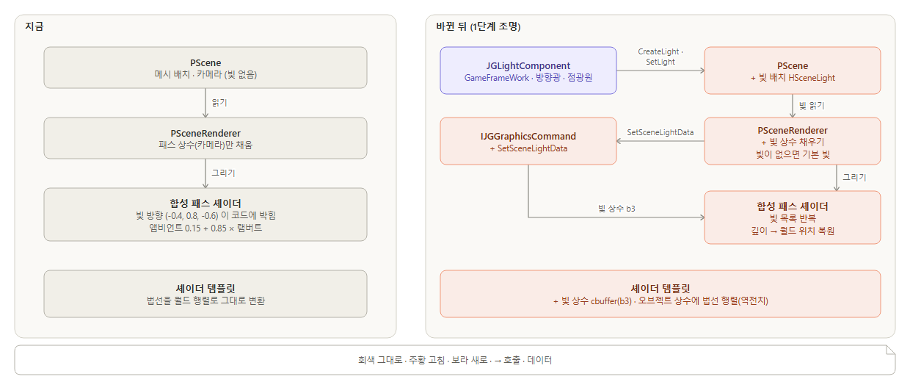
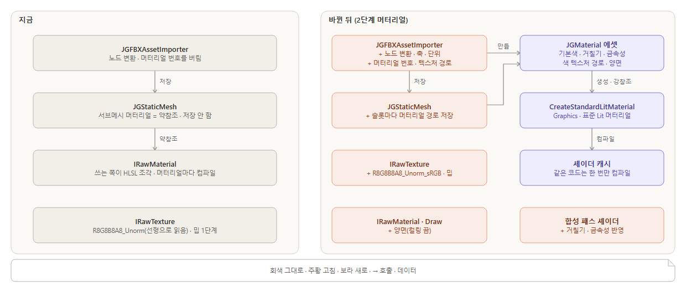
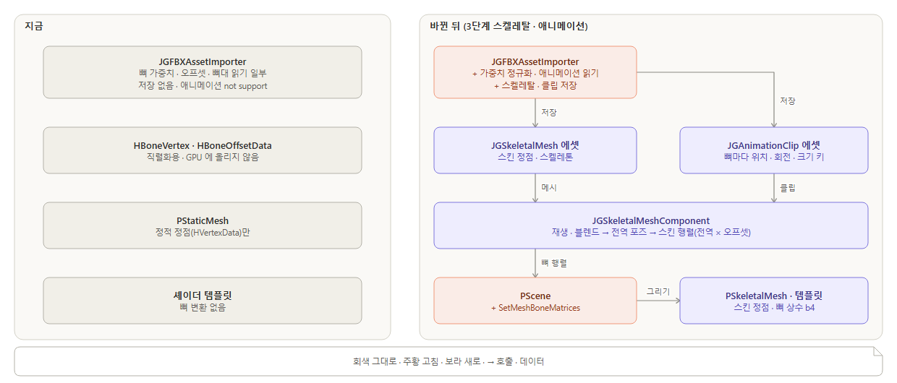

# 3D 렌더링 계획 · 코드 설계 — 조명 → 머터리얼 → 스켈레탈 · 애니메이션 (Engine-51, Graphics 초안 2026-10-24 19:03 · GameFrameWork 확인 반영 19:11)

사용자 답(보고함 Q-005, 18:52): "가) 빛부터". 덧붙임 원문은 "조명 => 머터리얼 => 스켈레탈, 애니메이션 / 이거에 대해서 계획 세우고 어떻게 코드를 작성할건지 보고해."
이 글은 세 단계의 계획과 설계도(CLAUDE.md 7절)다. 바탕은 렌더링 · 3D 검토(Engine-27) 기록 `Document/기록/Graphics/Engine-27_렌더링파이프라인_3D검토_2026-10-24.md` 이다. 코드는 아직 고치지 않았다.

## 결론

| 단계 | 끝나면 되는 것 | 대략 일수 | 담당 |
|---|---|---|---|
| 1. 조명 | 장면에 방향광 · 점광원을 놓고 옮기면 메시 밝기가 바뀐다. 축마다 크기가 다른 메시도 조명이 맞다 | 4~4.5 | Graphics 3.5 · GameFrameWork 0.5~1 |
| 2. 머터리얼 | 가져온 메시에 색 · 텍스처 · 거칠기 머터리얼을 에셋으로 붙인다. 색이 옅지 않고(sRGB), 언리얼 메시가 똑바로 선다(축 · 단위) | 6.5~8 | Graphics 3~3.5 · GameFrameWork 3~4 · Editor 0.5 |
| 3. 스켈레탈 · 애니메이션 | 뼈가 있는 메시를 가져와 걷기 · 달리기를 재생하고 섞는다 | 10.5~14.5 | Graphics 3.5~4.5 · GameFrameWork 7~10 |
| 시험 에셋 확보 | 스킨 메시는 저장소에 있는 `Content/RawResources/X Bot.fbx`(Mixamo, 스킨 · 뼈 있음)를 쓴다. 걷기 · 달리기 클립 FBX 만 따로 구한다. 1단계와 나란히 먼저 한다 | 0.5 | GameFrameWork |

- 합계는 대략 21~28 작업일이다(단계마다 문서 갱신 0.5일 포함). Graphics 와 GameFrameWork 가 나란히 하면 달력으로 3~4주 안팎이다. GameFrameWork 몫이 가장 길다.
- 세 단계 모두 지금 엔진의 짜임을 그대로 따른다.
  - 장면(`PScene`)은 데이터를 번호로 든다. 컴포넌트가 그 데이터를 등록 · 갱신한다(카메라 · 메시와 같은 방식).
  - 셰이더 상수는 루트 상수 버퍼를 하나씩 더해 넘긴다(빛 b3, 뼈 b4). 지금 패스 · 오브젝트 · 머터리얼 상수(b0~b2)와 같은 방법이다.
- 단계마다 `graphics.selftest` · `gfw.selftest` 에 판정을 더한다. 시험 게임(`Temp/Games/UnrealAssetTest`, git 밖)에서 에디터 캡처로 확인한다.
- 단계마다 같은 작업 안에서 문서도 고친다(CLAUDE.md 9절): 01. Graphics · 02. GameFrameWork 설계 설명, API Reference(Graphics · GameFrameWork), 모듈 README, 공개 헤더의 문서 주석, 변경 이력. 보고에는 추가 · 변경된 API 와 게임 프로젝트 영향을 적는다.
- GameFrameWork 몫(빛 컴포넌트 · 머터리얼 에셋 · FBX · 스켈레탈 에셋 · 재생 컴포넌트)은 GameFrameWork 세션이 코드를 보고 확인했다. GameFrameWork 세션이 덧붙인 점은 각 단계에 넣었다.
- 이 계획 밖: 그림자 · 에디터 3D 뷰포트(에디터 카메라 · 기즈모) · 캐릭터(입력 · 이동 · 충돌) · 투명 · 톤매핑. 세 단계가 끝난 뒤 따로 계획한다.

---

## 1단계 — 조명 (방향광 → 점광원)



**무엇을 왜:**
- 지금 빛은 합성 셰이더 코드에 고정 방향 하나로 박혀 있다(`SceneRenderer.cpp:23-25`). 그래서 빛을 놓거나 옮길 방법이 없다.
- 빛을 장면 데이터로 바꾸고, 빛 컴포넌트로 놓게 한다. 방향광부터 하고 점광원까지 간다.
- 법선은 지금 월드 행렬로 그대로 변환한다(`graphics_shader_template.hlsl:185-187`). 그래서 축마다 크기가 다르면 조명이 기운다. 이 단계에서 법선 행렬(역전치)로 고친다.

### 고칠 곳

| 모듈 | 파일 | 바뀌는 것 |
|---|---|---|
| Graphics | `Classes/Scene.h/.cpp` | `HSceneLightID` · `ESceneLightType`(Directional · Point) · `HSceneLight`(종류 · 방향 · 위치 · 색 · 세기 · 범위). `PScene::CreateLight` · `DestroyLight` · `FindLight` · `SetLight` · `GetLights`. 방향광은 방향만, 점광원은 위치 · 범위만 쓴다(주석에 적는다) |
| Graphics | `JGGraphicsDefine.h` | `HSceneLightCBData`(앰비언트 · 빛 수 · 빛 16개). `HObjectCBData` 에 `NormalMatrix` 를 더한다 |
| Graphics | `JGGraphicsCommand.h`, `DirectX12/DX12GraphicsCommand.h/.cpp` | `SetSceneLightData(const HSceneLightCBData&)`. 루트 서명에 빛 상수 버퍼(b3, 픽셀 셰이더) 하나를 더한다 |
| Graphics | `Classes/SceneRenderer.cpp` | 장면의 빛으로 빛 상수를 채운다(빛이 없으면 지금과 같은 기본 빛). 합성 셰이더가 빛 목록을 돈다. 점광원은 깊이로 월드 위치를 복원한다. 오브젝트 상수에 법선 행렬을 채운다 |
| Graphics | `Content/Shaders/graphics_shader_template.hlsl` | 빛 상수 cbuffer(b3) 선언 · 법선 · 접선을 `_NormalMatrix` 로 변환 |
| Graphics | `SelfTest/RenderSelfTest.cpp` | 지금 고정 빛과 같은 빛을 장면에 넣는다(기존 16가지 그대로). 판정 3가지를 더한다 |
| GameFrameWork | `Components/LightComponent.h/.cpp`(새) | `JGLightComponent`: 종류 · 색 · 세기 · 범위. BeginPlay → `CreateLight`, 틱 → `SetLight`(소유 액터 행렬의 +Z = 방향, 원점 = 위치), EndPlay → `DestroyLight` |
| GameFrameWork | `SelfTest/WorldSelfTest.cpp` | 빛 컴포넌트 등록 · 이동 · 파괴를 헤드리스로 판정한다 |
| 문서 | 01. Graphics(5절 · 그림 06 · 07) · 02. GameFrameWork(월드와 액터) · API Reference · README · 문서 주석 | 빛 API(`PScene` 빛 · `JGLightComponent`)를 더하고 변경 이력을 남긴다 |

### 바뀌기 전 · 뒤 (예제)

```cpp
// 지금 — Scene.h:65-75, SceneRenderer.cpp:23-25 (줄임). 장면에 빛이 없고, 빛은 셰이더 코드에 박혀 있다
HSceneMeshID   CreateMesh(const HSceneMesh& inMesh);
HSceneCameraID CreateCamera(const HSceneCamera& inCamera);

"float3 lightDir = normalize(float3(-0.4f, 0.8f, -0.6f));\n"
"float  ndl      = saturate(dot(normalize(normalW), lightDir));\n"
"_output.final   = float4(albedo.rgb * (0.15f + 0.85f * ndl), 1.0f);\n";
```

```cpp
// 바뀐 뒤 — Scene.h: 빛도 메시 · 카메라처럼 번호로 든다
enum class ESceneLightType : uint32 { Directional, Point };
struct HSceneLight { ESceneLightType Type; HVector3 Direction; HVector3 Position; HLinearColor Color; float32 Intensity = 1.0f; float32 Range = 10.0f; };   // 방향광은 Direction, 점광원은 Position · Range
HSceneLightID CreateLight(const HSceneLight& inLight);
bool          SetLight(HSceneLightID inID, const HSceneLight& inLight);

// SceneRenderer.cpp: 빛 상수(b3)를 채워 합성 패스로 넘긴다
HSceneLightCBData lightData;
fillLightData(inScene, lightData);              // 빛이 없으면 지금과 같은 기본 빛 하나
_graphicsCommand->SetSceneLightData(lightData);
"for (uint i = 0; i < _LightCount; ++i) { lit += evaluateLight(_Lights[i], positionW, normalW); }\n"
```

```cpp
// 바뀐 뒤 — GameFrameWork 에서 빛 놓기(JGCameraComponent 와 같은 등록 방식)
PSharedPtr<JGActor> sun = world->SpawnActor<JGActor>(PName("Sun"));
PSharedPtr<JGLightComponent> light = sun->AddComponent<JGLightComponent>();
light->SetLightType(ESceneLightType::Directional);   // 방향 = 액터 회전의 +Z
light->SetIntensity(0.85f);
```

### 확인

| 무엇으로 | 판정 |
|---|---|
| `graphics.selftest` | 기존 16가지가 그대로 통과한다(장면에 지금 고정 빛과 같은 빛). 더하는 것 셋: 빛 방향을 90° 돌리면 앞면 밝기가 앰비언트만 남는다 · 점광원을 앞면 앞에 두면 P1 밝기가 감쇠 식대로다 · 빛을 모두 지우면 기본 빛(지금 화면)과 같다 |
| `gfw.selftest` | 빛 컴포넌트 등록 → 장면 빛 1개, 액터를 돌리면 방향이 바뀜, 액터를 지우면 0개 |
| 에디터 | 시험 게임에 빛 액터를 놓고 돌리며 캡처 2장을 비교한다. 언리얼 그림이 담기므로 캡처는 `Temp/` 에만 둔다 |

### 일수 · 담당

- Graphics 3.5일: 방향광 · 빛 상수 1, 점광원 · 위치 복원 1, 법선 행렬 0.5, 시험 0.5, 문서 0.5.
- GameFrameWork 0.5~1일: 빛 컴포넌트 · 시험.
- Graphics 가 첫날 `PScene` 빛 API 를 먼저 올리면 GameFrameWork 가 바로 시작할 수 있다.

### 정해 둔 기본값

- 빛이 하나도 없으면 지금과 같은 기본 빛을 쓴다. 그래서 지금 화면 · 시험이 그대로다.
- 빛은 최대 16개다. 넘으면 경고 로그를 남기고 넘는 빛은 쓰지 않는다. 수십 개가 필요해지면 그때 타일 조명으로 바꾼다.
- 이 단계의 조명 식은 램버트(밝기 = 법선 · 빛 방향)다. 거칠기 · 금속성은 2단계에서 반영한다.
- 게임 프로젝트 영향: 없다. 새 API 만 더하고, 빛을 놓지 않은 게임은 지금 화면 그대로다.

---

## 2단계 — 머터리얼 (표준 Lit · 머터리얼 에셋 · sRGB)



**무엇을 왜:**
- 지금은 머터리얼을 저장할 수 없다. 서브메시는 머터리얼을 약참조로 든다. 그래서 아무도 강참조로 들지 않으면 흰 기본 머터리얼로 돌아간다(`StaticMesh.h:18`, `StaticMeshAsset.cpp:92-102`).
- 텍스처 하나를 입히려 해도 쓰는 쪽이 HLSL 조각을 직접 써야 한다. 그리고 머터리얼마다 셰이더를 따로 컴파일한다(`DX12Material.cpp:490-506`).
- 색 텍스처는 선형으로 읽혀 옅게 보인다(`JGGraphicsDefine.h:32-50`).
- 언리얼 FBX 는 축 · 단위가 맞지 않고 머터리얼 연결도 없다(언리얼 에셋 가져오기 Engine-26 기록 4절).
- 이 단계에서 표준 Lit 머터리얼 하나와 그 값을 담는 머터리얼 에셋을 만든다.

### 고칠 곳

| 모듈 | 파일 | 바뀌는 것 |
|---|---|---|
| Graphics | `JGGraphicsDefine.h`, `DirectX12/Classes/DirectX12Helper.cpp` | `ETextureFormat::R8G8B8A8_Unorm_sRGB` 를 더한다(DXGI `R8G8B8A8_UNORM_SRGB`). 셰이더가 읽을 때 선형으로 바뀐다 |
| Graphics | `DirectX12/DX12Material.cpp`, `Classes/ShaderLibrary.h/.cpp` | 셰이더 캐시: 전체 셰이더 코드 + 매크로가 같으면 컴파일한 셰이더 하나를 나눠 쓴다 |
| Graphics | `Classes/StandardMaterial.h/.cpp`(새) | `CreateStandardLitMaterial(name)`: 프로퍼티 BaseColor(Float4) · BaseColorTex(Texture) · Roughness · Metallic 과 고정 셰이더 코드를 가진 Surface 머터리얼을 만든다. 로드 스레드에서 불러도 된다(아래 기본값) |
| Graphics | `Classes/Material.h`, `DirectX12/DX12GraphicsCommand.cpp` | `HRawMaterialConstructArguments::bTwoSided` · `IRawMaterial::IsTwoSided()`. 그릴 때 양면이면 컬링을 끈다 |
| Graphics | `Classes/SceneRenderer.cpp` | 합성 셰이더가 G버퍼의 거칠기 · 금속성을 읽어 반사광(GGX)을 더한다. 합성 머터리얼에 텍스처 하나(GSpecular)를 더한다 |
| GameFrameWork | `Asset/MaterialAsset.h/.cpp`(새) | `JGMaterial` 에셋: BaseColor · Roughness · Metallic · BaseColorTexture(에셋 경로) · TwoSided 를 .jgasset 에 저장한다. 불러오면 표준 Lit 머터리얼을 만들어 강참조로 든다 |
| GameFrameWork | `Asset/StaticMeshAsset.h/.cpp`, `Components/StaticMeshComponent.h/.cpp` | 서브메시마다 머터리얼 에셋 경로를 저장 · 불러오기 한다. 컴포넌트에 `LoadMaterial(slot, path)` 를 둔다. 컴포넌트는 메시를 받으면 에셋의 슬롯 머터리얼을 먼저 넣고, `LoadMaterial` 은 그 위에 덮어쓴다 |
| GameFrameWork | `Asset/Importers/FBXAssetImporter.cpp`, 텍스처 가져오기(Engine-28) | 노드 변환을 정점에 곱한다. 법선은 역전치로 곱하고, 행렬식이 음수(거울)면 감김 순서를 뒤집는다. 한 메시를 노드 여럿이 쓰면 노드마다 복제한다(FBX 에서 보이는 그대로). 위 축 · 단위의 기본값은 FBX 안 설정(`UpAxis` · `UnitScaleFactor`)에서 읽는다. 컨텐츠 브라우저 `ImportAssetFile`(Engine-30)은 옵션 없이 바로 가져오기 때문이다. `mMaterialIndex` → 서브메시 슬롯, `aiMaterial` → `JGMaterial`(이름은 `<이름>_Mat`. 접미사가 없으면 메시 에셋과 이름이 같아져 같은 폴더의 .jgasset 을 덮어쓰기 때문이다). 색 텍스처는 sRGB 포맷으로 하고, 가져올 때 밉을 만든다(`stb_image_resize2`) |
| Editor | 컨텐츠 브라우저(Engine-25) | `JGMaterial` 종류를 표시한다 |
| 문서 | 01. Graphics(4 · 7절 · 그림 05 · 09) · 02. GameFrameWork(05. 에셋) · API Reference · README · 문서 주석 | 표준 Lit · sRGB 포맷 · 양면 · `JGMaterial` · `LoadMaterial` 을 더하고 변경 이력을 남긴다 |

### 바뀌기 전 · 뒤 (예제)

```cpp
// 지금 — RenderSelfTest.cpp:364-378 (줄임). 프로퍼티 정의 · HLSL 조각 · 컴파일을 쓰는 쪽이 직접 한다
HRawMaterialConstructArguments materialArgs;
materialArgs.Domain = EMaterialDomain::Surface;
materialArgs.PropertyDefinitionist.DefineTexture(PName("AlbedoTex"));
_texturedMaterial = GetGraphicsAPI().CreateRawMaterial(materialArgs);
_texturedMaterial->SetTexture(PName("AlbedoTex"), _texture);
compileArgs.ShaderCode = "_output.albedo = AlbedoTex;";
_texturedMaterial->Compile(compileArgs);                   // 머터리얼마다 셰이더 컴파일(DX12Material.cpp:499)
```

```cpp
// 바뀐 뒤 — Graphics: 표준 Lit 머터리얼. 같은 셰이더는 캐시로 한 번만 컴파일한다
PSharedPtr<IRawMaterial> material = CreateStandardLitMaterial(PName("Crate"));
material->SetTexture(PName("BaseColorTex"), crateTexture);   // R8G8B8A8_Unorm_sRGB
material->SetFloat(PName("Roughness"), 0.7f);

// GameFrameWork: 머터리얼은 에셋으로 저장하고, 메시 슬롯에 경로로 붙인다
meshComponent->LoadStaticMesh(HAssetPath("/JGGame/Unreal/Meshes/SM_Crate"));
meshComponent->LoadMaterial(0, HAssetPath("/JGGame/Unreal/Materials/M_Crate"));
```

### 확인

| 무엇으로 | 판정 |
|---|---|
| `graphics.selftest` | sRGB 텍스처(200, 100, 50)를 읽으면 선형 기대값이다 · 같은 표준 Lit 머터리얼 두 개가 셰이더 하나를 나눠 쓴다 · 양면 머터리얼은 뒤집힌 판의 뒷면도 그린다 · 거칠기 · 금속성 반사광이 식대로다 · 로드 스레드에서 만든 표준 Lit 머터리얼로 그린 결과가 메인 스레드에서 만든 것과 같다 |
| `gfw.selftest` | `JGMaterial` 저장 → 불러오기 값이 같다 · 메시 슬롯 경로가 왕복한다 · 언리얼 Cube FBX 경계 상자가 ±0.5 m 이고 Y 가 위다 |
| 에디터 | 시험 게임의 언리얼 메시가 텍스처째, 똑바로 선 모습으로 보이는지 캡처한다(`Temp/` 에만) |

### 일수 · 담당

- Graphics 3~3.5일: sRGB 0.5, 셰이더 캐시 0.5, 표준 Lit · 반사광 1~1.5, 양면 0.5, 문서 0.5.
- GameFrameWork 3~4일: `JGMaterial` 1.5, 메시 슬롯 0.5~1, FBX 노드 변환 · 축 · 단위 · 머터리얼 번호 1, 밉 0.5.
- Editor 0.5일.
- 따로 된 PNG · TGA 텍스처 가져오기는 에셋 가져오기 진입점(Engine-28) 몫이다. 이 단계의 텍스처 입력은 그 결과를 쓴다.

### 정해 둔 기본값

- 첫 판의 머터리얼은 "표준 Lit" 하나뿐이다. 노멀 맵 · 발광 · 투명은 쓸 일이 생기면 더한다.
- `JGMaterial` 이 텍스처를 비동기로 불러오는 동안은 기본(흰) 텍스처로 그린다.
- `JGMaterial::ReadJson` 이 로드 스레드에서 돈다. 그래서 `CreateStandardLitMaterial` 은 로드 스레드에서 불러도 되게 만든다.
  - 텍스처 · 버퍼 생성은 이미 로드 스레드에서 돈다. 장치(`DirectX12API.cpp:337`) · 디스크립터 할당(`DescriptionAllocator.cpp:7`) · 상수 버퍼(`DX12ConstantBuffer.cpp:123`)에 잠금이 있다.
  - 새 셰이더 캐시에만 잠금을 둔다. 셰이더 컴파일(`D3DCompile2`)은 스레드에 안전하다.
  - 만든 머터리얼은 로드 콜백(메인 스레드)으로 넘어온 뒤에 그린다. 에셋 DB 가 불러온 에셋을 강참조로 들고, `JGMaterial` 이 머터리얼을 강참조로 든다. 그래서 약참조 문제(흰 기본 머터리얼로 돌아감)가 풀린다.
- 게임 UI 텍스처(`PGameUIManager::LoadTexture`)는 지금처럼 UNORM 으로 둔다. 2D 는 sRGB 디스플레이 텍스처에 값을 그대로 쓴다. 그래서 UI 텍스처를 sRGB 로 바꾸면 UI 가 어두워진다. sRGB 는 3D 머터리얼의 색 텍스처에만 쓴다.
- 게임 프로젝트 영향: 없다. 새 API 만 더한다. 메시 에셋에 "Material" 경로가 늘지만 옛 에셋은 그대로 읽는다(경로가 없으면 기본 머터리얼).

---

## 3단계 — 스켈레탈 메시 · 애니메이션



**무엇을 왜:**
- 지금 FBX 가져오기는 뼈 가중치 · 오프셋 · 뼈대 읽기 코드가 일부만 있다(`FBXAssetImporter.cpp:320-439`). 저장은 없고, 애니메이션은 "not support" 로그만 낸다(`FBXAssetImporter.cpp:441-443`).
- `HBoneVertex` 는 직렬화용이라 GPU 에 올릴 수 없다(`JGGraphicsDefine.h:289-333`). 렌더 정점에도 뼈 번호 · 가중치가 없다.
- 이 단계에서 스킨 메시 렌더링(Graphics)과 에셋 · 재생(GameFrameWork)을 만든다.

### 고칠 곳

| 모듈 | 파일 | 바뀌는 것 |
|---|---|---|
| Graphics | `JGGraphicsDefine.h` | `HSkinnedVertexData` = `HVertexData` + 뼈 번호 4(`HVector4Int`, Int4) + 가중치 4(Float4). GPU 에 그대로 올리는 POD 이고 입력 레이아웃은 BLENDINDICES · BLENDWEIGHT 다. `HDrawArguments` 에 뼈 행렬 목록 포인터를 더한다 |
| Graphics | `Classes/SkeletalMesh.h/.cpp`(새) | `PSkeletalMesh : IMesh`. 서브메시는 `HRenderSubMesh` 를 그대로 쓰고, 입력 레이아웃만 스킨 정점이다 |
| Graphics | `Classes/Scene.h/.cpp`, `Classes/SceneRenderer.cpp` | `HSceneMesh` 에 뼈 행렬을 더하고 `PScene::SetMeshBoneMatrices(id, matrices)` 를 둔다. 렌더러가 그리기 인자로 넘긴다 |
| Graphics | `DirectX12/DX12GraphicsCommand.cpp`, `DirectX12/DX12Material.cpp` | 루트 서명에 뼈 상수 버퍼(b4, 정점 셰이더, 최대 256개)를 더한다. 스킨 메시를 처음 그릴 때 머터리얼의 스킨 변형(매크로 `JG_SKINNED=1`)을 컴파일한다. 셰이더 캐시를 같이 쓴다 |
| Graphics | `Content/Shaders/graphics_shader_template.hlsl` | `#if JG_SKINNED` 이면 정점 입력에 뼈 번호 · 가중치를 받고, 위치 · 법선 · 접선을 뼈 행렬 가중합으로 변환한다 |
| Graphics | `SelfTest/RenderSelfTest.cpp` | 뼈 2개짜리 막대 메시로 스키닝을 판정한다 |
| GameFrameWork | `Asset/SkeletalMeshAsset.h/.cpp`(새) | `JGSkeletalMesh`: 스킨 정점 · 인덱스 · 스켈레톤(뼈 이름 · 부모 · 바인드 포즈 · 오프셋) · 머터리얼 경로. 첫 판은 스켈레톤을 메시 에셋 안에 둔다. `GetMesh()` → `PSkeletalMesh` |
| GameFrameWork | `Asset/AnimationClipAsset.h/.cpp`(새) | `JGAnimationClip`: 길이 · 뼈 이름마다 위치 · 회전 · 크기 키. `Sample(time, outLocalPose)`. 키를 뼈 번호가 아니라 이름으로 든다. 그래야 나중에 스켈레톤을 따로 떼어 여러 캐릭터가 클립을 나눠 써도 형식이 그대로다 |
| GameFrameWork | `Asset/Importers/FBXAssetImporter.cpp` | 가중치 정규화(합 1) · `ReadAnimation` 구현 · 스켈레탈 메시와 클립 저장. 지금 있는 `HSkeletalStock` · `HAnimationClipStock` 을 바탕으로 한다 |
| GameFrameWork | `Components/SkeletalMeshComponent.h/.cpp`(새) | `JGSkeletalMeshComponent`: `LoadSkeletalMesh(path)` · `PlayAnimation(path, loop)` · `CrossFadeTo(path, seconds)`(`LoadStaticMesh` 와 같은 꼴). `PlayAnimation` 때 뼈 이름 → 번호 표를 한 번 만든다. 샘플 · 블렌드 · 스킨 행렬 계산은 `PScene` 없이 부를 수 있는 함수로 둔다(헤드리스 시험). 틱마다 샘플 → 블렌드 → 전역 포즈 → 스킨 행렬(전역 × 오프셋) → `PScene::SetMeshBoneMatrices` 차례로 한다 |
| 문서 | 01. Graphics(7절 · 그림 09) · 02. GameFrameWork(01. 월드와 액터 · 05. 에셋) · API Reference · README · 문서 주석 | `PSkeletalMesh` · 스킨 정점 · `JGSkeletalMesh` · `JGAnimationClip` · `JGSkeletalMeshComponent` 를 더하고 변경 이력을 남긴다 |

### 바뀌기 전 · 뒤 (예제)

```cpp
// 지금 — FBXAssetImporter.cpp:151-160, 441-443 (줄임). 애니메이션은 읽기만 부르고 저장하지 않는다
if (scene->HasAnimations() == true && EnumHasAnyFlags(_args.Flags, EFBXAssetImportFlags::Import_AnimationClip))
{
	ReadAnimation(anim, &animClipStock);
	//WriteAnimation(setting.OutputPath, animInfo);
}
void JGFBXAssetImporter::ReadAnimation(const aiAnimation* anim, HAnimationClipStock* outStock)
{
	JG_LOG(Asset, ELogLevel::Error, "%s not support Read Animation", _args.SrcPath);
}
```

```hlsl
// 바뀐 뒤 — graphics_shader_template.hlsl: 스킨 변형만 뼈 행렬 가중합으로 정점을 옮긴다
#if JG_SKINNED
	float4x4 skin = _BoneMatrices[vin.boneIDs.x] * vin.boneWeights.x + _BoneMatrices[vin.boneIDs.y] * vin.boneWeights.y
	              + _BoneMatrices[vin.boneIDs.z] * vin.boneWeights.z + _BoneMatrices[vin.boneIDs.w] * vin.boneWeights.w;
	posL    = mul(float4(posL, 1.0f), skin).xyz;
	normalL = mul(float4(normalL, 0.0f), skin).xyz;
#endif
```

```cpp
// 바뀐 뒤 — GameFrameWork 에서 캐릭터 재생
PSharedPtr<JGSkeletalMeshComponent> body = hero->AddComponent<JGSkeletalMeshComponent>();
body->LoadSkeletalMesh(HAssetPath("/JGGame/Test/Character"));
body->PlayAnimation(HAssetPath("/JGGame/Test/Anim_Walk"), true);
body->CrossFadeTo(HAssetPath("/JGGame/Test/Anim_Run"), 0.25f);   // 걷기 → 달리기를 0.25초 동안 섞는다
```

### 확인

| 무엇으로 | 판정 |
|---|---|
| `graphics.selftest` | 뼈 행렬이 모두 단위 행렬이면 정적 메시와 같은 그림이다 · 뼈 2개 막대에서 둘째 뼈를 90° 돌리면 덮인 픽셀 수와 프로브 색이 계산대로다 |
| `gfw.selftest`(새 그룹 animation) | 키 사이 보간값 · 50% 블렌드 값 · 바인드 포즈에서 스킨 행렬이 단위 행렬 · FBX 시험 에셋 뼈 수 · 클립 길이(헤드리스) |
| 에디터 | 시험 캐릭터가 걷다가 달리기로 섞이는 모습을 몇 장 캡처한다 |

### 일수 · 담당

- Graphics 3.5~4.5일: 스킨 정점 · `PSkeletalMesh` 1, 뼈 상수 · 스킨 셰이더 변형 1~1.5, 시험 1~1.5, 문서 0.5.
- GameFrameWork 7~10일: 에셋 · 가져오기 4~5, 재생 · 블렌드 3~5.
- 시험 에셋: 스킨 메시는 저장소에 있는 `Content/RawResources/X Bot.fbx`(Mixamo)를 쓴다. 스킨(Deformer 130) · 뼈(mixamorig, 뼈 노드 66)가 있다. 애니메이션은 짧은 기본 테이크뿐이다. 그래서 걷기 · 달리기 클립 FBX 만 따로 구한다(0.5일, 1단계와 나란히). 새로 구한 클립은 저장소에 넣지 않는다.

### 정해 둔 기본값

- 정점 하나의 뼈는 최대 4개이고, 한 메시의 뼈는 최대 256개다. 넘으면 가져올 때 경고하고 큰 가중치 4개만 남긴다.
- 스키닝은 정점 셰이더에서 한다. 컴퓨트 셰이더 스키닝은 캐릭터가 많아질 때 따로 한다.
- 블렌드는 두 클립 사이 크로스페이드 하나다. 블렌드 스페이스 · 상태 기계는 데모에서 필요해지면 더한다.
- 게임 프로젝트 영향: 없다. 새 에셋 · 컴포넌트만 더한다.

---

## 일정 · 순서

| 차례 | Graphics | GameFrameWork | Editor |
|---|---|---|---|
| 1주 | 1단계 조명(3.5일, 문서 포함) — 첫날 `PScene` 빛 API 먼저 | 빛 컴포넌트(0.5~1) · 걷기 · 달리기 클립 확보(0.5) · Engine-30 컨텐츠 브라우저 마무리 | — |
| 2주 | 2단계: sRGB · 셰이더 캐시 · 표준 Lit · 양면(3~3.5, 문서 포함) | 2단계: `JGMaterial` · 메시 슬롯 · FBX 축 · 단위 · 머터리얼 번호 · 밉(3~4). PNG · TGA 가져오기(Engine-28)와 같이 | `JGMaterial` 표시(0.5) |
| 3~4주 | 3단계 스키닝(3.5~4.5, 문서 포함) | 3단계: 에셋 · 가져오기 · 재생 · 블렌드(7~10) | — |

- 단계마다 차례는 같다: 일감 열기 → 구현 → 빌드(MainTree) → `graphics.selftest` · `gfw.selftest` → 에디터 캡처 → 문서 갱신(01. Graphics · 02. GameFrameWork · API Reference · README · 문서 주석 · 변경 이력) → 보고(바뀐 API · 게임 영향).
- 이 글이 세 단계의 설계도다. 확인을 받으면 1단계는 이 설계도대로 바로 구현한다. 2 · 3단계는 앞 단계 결과를 보고, 바뀐 점만 짧게 다시 확인받는다.

---

## 사용자에게 물을 것

- **물음:** 이 계획대로 1단계 조명부터 구현을 시작할까요?
- **지금 생기는 일:** 3D 메시는 흰 기본 머터리얼과 셰이더에 박힌 빛 하나로만 보인다. 빛 · 머터리얼 · 애니메이션을 데이터로 줄 방법이 없다.
- **언제:** 3D 장면 작업을 시작할 때부터 생긴다. 가져온 언리얼 메시(Engine-26)도 지금은 흰 머터리얼과 고정 빛으로만 보인다.

| 선택지 | 고르면 일어나는 일 |
|---|---|
| 이 계획대로 조명부터 구현 시작(권고) | 엔진 총괄이 1단계 일감을 연다. Graphics 가 구현 · 시험 · 캡처까지 하고 보고한다. GameFrameWork 는 빛 컴포넌트와 걷기 · 달리기 클립 확보를 나란히 한다. 2 · 3단계는 앞 단계 보고 뒤 하나씩 진행한다 |
| 계획을 고쳐 다시 보고 | 아직 구현하지 않는다. 고칠 점을 적어 주시면 그 부분만 고쳐 다시 올린다. 예: "빛이 없으면 어둡게", "그림자를 조명 단계에 넣기", "머터리얼을 먼저" |

- **권고:** "이 계획대로 조명부터 구현 시작". 엔진의 지금 짜임을 그대로 따르고, 단계마다 시험으로 전후를 잴 수 있기 때문이다.
- **급한지:** 급하지 않다. 답이 없으면 아무것도 고치지 않는다.

---

## 기록 · 그림

- 이 글: `Document/기록/Graphics/Engine-51_3D렌더링계획_2026-10-24.md`
- 그림(원본 .svg 와 .png, 같은 폴더): `Engine-51_1_Light` · `Engine-51_2_Material` · `Engine-51_3_Skeletal`
- 보고함용 그림: `Saved/UIShots/Engine-51_Plan_1_Light.png` · `Engine-51_Plan_2_Material.png` · `Engine-51_Plan_3_Skeletal.png`
- 그림은 위키 그리개(`Tools/Ops/wiki_svg/render.js`)로 그렸다. 세 장 모두 점검을 통과했다.
